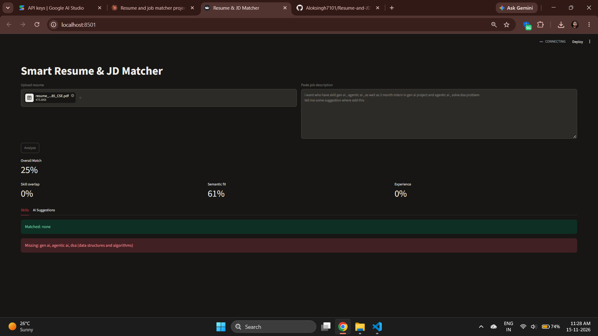
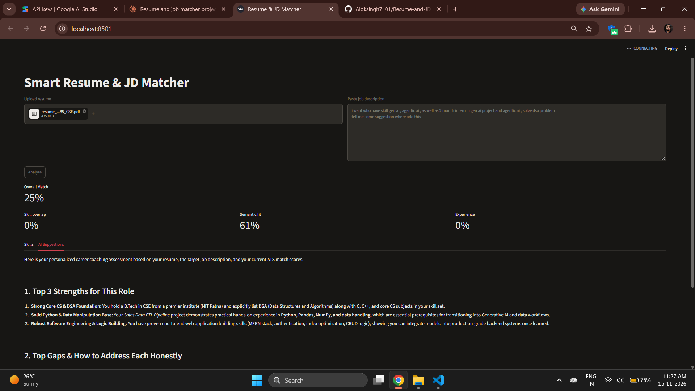
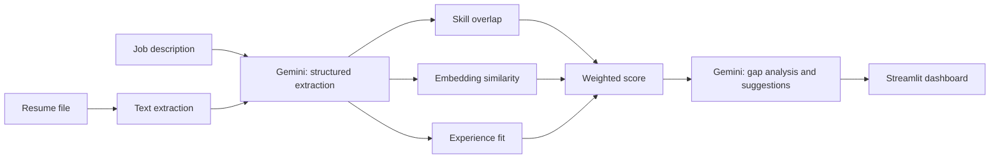

# Smart Resume & Job Description Matcher

A GenAI web app that compares a resume against a job description and tells you **how well they match, what is missing, and how to improve the resume**, without inventing experience.


| Skills tab | AI suggestions tab |
|---|---|
|  |  |

---

## Problem

Job seekers often don't know why their resume gets rejected. Keyword checkers only look for exact word matches, so they miss that "built REST services" and "API development" mean the same thing. This project scores a resume on **both exact skills and meaning**, then explains the gaps in plain language.

## Features

- Upload a resume (PDF, DOCX, or TXT) and paste any job description
- LLM-based extraction of skills, tools, experience, and requirements into structured JSON
- **Hybrid match score** combining exact skill overlap, semantic similarity, and experience fit
- Clear breakdown of matched and missing skills
- AI-written strengths, gaps, and rewritten resume bullets tailored to the job
- Guardrail in the prompt: the model may only rephrase what is already in the resume, never invent skills or numbers

## How it works



1. **Parse**: `pdfplumber` / `python-docx` convert the resume to text.
2. **Extract**: Gemini returns validated JSON (skills, tools, years of experience, requirements).
3. **Score**: three signals are combined.
4. **Explain**: Gemini receives the resume, the job description, and the scores, then writes strengths, gaps, and improved bullets.

### Scoring

| Signal | Weight | What it measures |
|---|---|---|
| Skill overlap | 40% | Share of the job's required skills found in the resume (exact match) |
| Semantic fit | 40% | Meaning-level similarity between resume lines and job requirements, using Gemini embeddings and cosine similarity |
| Experience fit | 20% | Years of experience compared with the job's minimum |

The weights are a starting point and can be tuned using the evaluation below.

## Tech stack

| Layer | Tool |
|---|---|
| Language | Python |
| LLM and embeddings | Google Gemini API (`google-genai`) |
| File parsing | `pdfplumber`, `python-docx` |
| Math | `numpy` |
| UI | Streamlit |

No model is downloaded locally. All AI calls go through the Gemini API, so the app is lightweight and easy to deploy.

## Project structure

```
resume-matcher/
├── app.py          # Streamlit UI
├── reader.py       # PDF / DOCX / TXT to text
├── llm.py          # Gemini client with retry and JSON mode
├── extractor.py    # Structured extraction prompts
├── matcher.py      # Embeddings and scoring
├── analysis.py     # Gap analysis and resume suggestions
├── requirements.txt
└── README.md
```

## Setup

```bash
git clone https://github.com/Aloksingh7101/Resume-and-JD-matcher
cd resume-matcher
python -m venv venv
venv\Scripts\activate            # Mac/Linux: source venv/bin/activate
pip install -r requirements.txt
```

Create a `.env` file in the project root:

```
GEMINI_API_KEY=***************
```

Get a free key at [Google AI Studio](https://aistudio.google.com). Then run:

```bash
streamlit run app.py
```

## Evaluation

## Evaluation

I tested the scorer on 10 resume/job pairs that I labeled by hand as Strong, Medium, or Weak.

| Pair | Job | My label | App score |
|---|---|---|---|
| 1 | GenAI intern | Weak | 25% |
| 2 | ... | ... | ... |

**Result:** Strong pairs averaged __% vs __% for Weak pairs. __ of 10 pairs ranked in the correct order.

**Finding:** Testing showed the experience score misread "2 month internship" as 2 years. I fixed the extraction prompt and the scoring rule, and re-ran the pairs.


## Limitations

- Scanned (image-only) PDFs are not supported because there is no OCR step
- Skill overlap uses exact text matching, so unusual spellings of the same skill can be missed
- Scores depend on how accurately the LLM extracts skills; they are a guide, not a hiring decision
- Free-tier Gemini quotas limit how many analyses can run per minute

## Privacy

Resume text is sent to the Gemini API for processing. Use your own resume or one with personal details removed when testing or demoing.

## Future improvements

- Rank many resumes against one job description (recruiter view)
- Export the improved resume as DOCX
- Skill normalization using a skills taxonomy (for example ESCO or O*NET)
- Remove names, emails, and phone numbers before sending text to the API
- Cache results to reduce API usage

## Author

Alok singh: [GitHub](https://github.com/Aloksingh7101)
